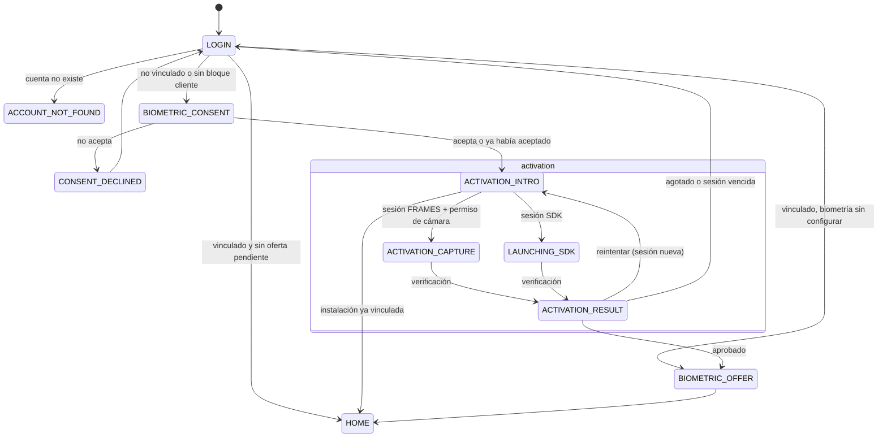
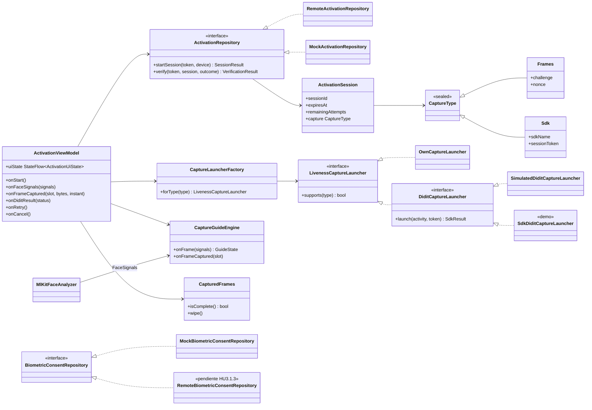
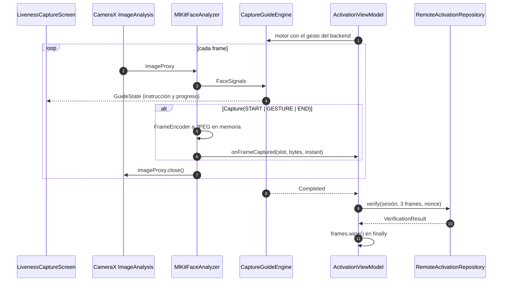
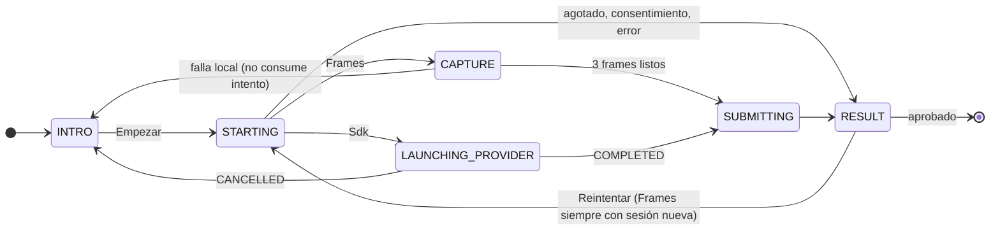

# HU3.1.1 · Arquitectura visual (app Android)

Complementa [HU3.1.1-plan-tecnico.md](HU3.1.1-plan-tecnico.md). Los diagramas de sistema (componentes, despliegue, secuencias entre servicios, estados de sesión e intento, modelo de datos) son canónicos en `solventa-backend/docs/planning/HU3.1.1-diagramas.md`. Aquí solo va lo propio de la app. Lo punteado es Didit (demostración, desactivado por defecto).

## 1. Navegación

## 2. Clases

## 3. Captura `FRAMES` dentro de la app

## 4. Estado de la pantalla de activación

