# HU3.1.1 · Activación móvil con selfie y prueba de vida · Plan técnico (app Android)

- Historia: [#87](https://github.com/dzamoranouniandes/misw4501-grupo3-solventa-backend/issues/87) · Sprint 2 (19/10/2026 – 01/11/2026) · 13 pts
- Rama: `feat/HU3.1.1-activacion-selfie-prueba-vida` (sale de `dev`)
- Diagramas de la app (navegación, clases, captura, estados): [HU3.1.1-diagramas.md](HU3.1.1-diagramas.md). Los de sistema están en `solventa-backend/docs/planning/HU3.1.1-diagramas.md`.
- Backend correspondiente: `solventa-backend/docs/planning/HU3.1.1-plan-tecnico.md` (misma rama). **El contrato de la sección 4 es el mismo en ambos documentos; si cambia, se cambia en los dos.**
- Relacionadas: HU3.1.2 biometría de acceso (ya en `dev`) y HU3.1.3 consentimiento biométrico ([#89](https://github.com/dzamoranouniandes/misw4501-grupo3-solventa-backend/issues/89)). La pantalla y la capa de datos del consentimiento se hacen **en esta historia**, simuladas hasta que HU3.1.3 entregue el endpoint (sección 3.7).

> Insumo para el agente que implementa. Describe **qué** construir y **cómo** encaja con el código existente.

---

## 0. Alcance y decisiones de base

- **Para qué es la prueba de vida:** activar el acceso móvil **una vez por instalación**: verificar que quien abre la app es el titular de la cuenta creada en la web y vincular el teléfono (F3.1). Los accesos siguientes usan huella o rostro del sistema (HU3.1.2). **No** es el KYC/AML para adquirir una póliza (flujo web de HU1.3.3, dueño de `estado_kyc`): la app **no** cambia `estadoKyc` al aprobar.
- **Orden del flujo:** login con la cuenta web → consentimiento biométrico → selfie con prueba de vida → dispositivo vinculado → oferta de huella o rostro (HU3.1.2) → inicio. Se repite la prueba solo con otra instalación (otro teléfono o reinstalación).
- **Proveedores (diseño del experimento HA12, `../experimentos`):** quien elige y aplica el proveedor de prueba de vida es el microservicio **`liveness_adapter`** del backend.
  - **Patrones:** Strategy por proveedor y Factory.
  - **Proveedor activo:** se cambia por endpoint (`PUT /admin/liveness-provider`). El proveedor **no se expone** a la app.
  - **Qué recibe la app:** al crear la sesión, solo **cómo capturar** (`captura.tipo`). La app tiene un **lanzador por tipo de captura** (Strategy):
  - `FRAMES` (proveedor `propio`, **activo por defecto y el primero en construirse**): cámara propia (CameraX) con guía de ML Kit; envía 3 frames y el backend verifica el gesto.
  - `SDK` con `sdk.nombre = "DIDIT"` (proveedor `didit`, **solo demostración, desactivado por defecto, costo cero**): dos lanzadores intercambiables, el **simulado** (por defecto) y el **SDK real** de Didit, este último detrás de `solventa.diditSdkEnabled=false`. Solo llega si el backend tiene Didit habilitado y dentro de su tope gratuito.
  - Cambiar el proveedor en el backend no toca la app. Agregar un SDK nuevo solo agrega un lanzador, sin tocar ViewModel ni pantallas.
  - **Orden de trabajo (D9):**
    1. Primero el patrón de lanzadores y la captura `FRAMES` de punta a punta (T-M01–T-M12).
    2. Después el SDK de Didit (T-M13), que también se implementa en esta historia. Responsable: Sergio Gelvez. Estimación: 6 h.
    - Queda desactivado por defecto (`solventa.diditSdkEnabled=false`, lanzador simulado).
  - **Riesgo aceptado (D8):** `FRAMES` valida el gesto y una consistencia básica, pero no es PAD certificado ni evita por completo una secuencia grabada. Se acepta para el alcance académico.
- **El reto (gesto + nonce) lo emite el servidor**, no la app. ML Kit en la app solo guía al usuario y elige los momentos de captura; el veredicto es del backend.

---

## 1. Criterios de aceptación → decisión técnica

| # | Criterio | En la app |
|---|---|---|
| CA1 | Sin cuenta previa → mensaje y enlace al registro web | `AccountNotFoundScreen` + `BuildConfig.WEB_SIGNUP_URL` ya existen. Como Cognito responde 401 en ambos casos, el login muestra **siempre** el enlace "¿Aún no tienes cuenta? Regístrate en la web". `404 CLIENTE_NO_REGISTRADO` en la activación → `AccountNotFoundScreen`. |
| CA2 | Selfie con cámara frontal | Captura `FRAMES`: CameraX `DEFAULT_FRONT_CAMERA`, permiso `CAMERA` en tiempo de ejecución. Captura `SDK`: la hace el SDK del proveedor (simulado por defecto). |
| CA3 | Prueba de vida con gesto | El backend asigna el gesto (`BLINK`, `TURN_LEFT`, `TURN_RIGHT`). La app guía con ML Kit y captura `inicio` (neutro), `gesto` (pico) y `fin` (neutro); el backend verifica el gesto sobre esos frames. |
| CA4 | Envío seguro al proveedor | `multipart/form-data` por HTTPS al BFF Móvil con `Authorization: Bearer`. La app nunca habla con el proveedor de verificación. |
| CA5 | Éxito → vinculado; fallo → reintento (máx. 3) | El backend lleva el contador (`intento`, `intentos_restantes`). Al aprobar: `dispositivoVinculado = true` en la sesión → oferta biométrica de HU3.1.2. |
| CA6 | Trazabilidad | La persiste el backend. La app envía `installation_id`, datos del dispositivo y las marcas de tiempo de cada frame. |
| CA7 | La selfie no se almacena | Frames solo en memoria (`ByteArray`), sobrescritos con ceros en el `finally` del envío y en `onCleared`. Nunca archivos (ni `OutputFileOptions` ni caché). `FLAG_SECURE` en la captura. Sin logs. `allowBackup=false` ya está activo. |

---

## 2. Arquitectura y patrones

Se mantiene el estilo actual: **MVVM + UDF** (`StateFlow<UiState>`, eventos como funciones, navegación con un `destination` que la UI consume y limpia), **repositorio detrás de interfaz** con versión simulada y remota según `BuildConfig`, y **DI manual** en `AppContainer`.

| Patrón | Dónde | Por qué |
|---|---|---|
| Strategy + Factory | `LivenessCaptureLauncher` por `CaptureType` (`OwnCaptureLauncher` para `FRAMES`, `DiditCaptureLauncher` para `SDK`/`DIDIT`), creados por `CaptureLauncherFactory` | Misma idea que el adaptador del backend: el tipo de captura llega en tiempo de ejecución y cada estrategia lo resuelve a su manera. |
| Adapter | `MlKitFaceAnalyzer`: `com.google.mlkit.vision.face.Face` → `FaceSignals` | La lógica de guía no depende de ML Kit; se prueba con JUnit puro. |
| State machine | `CaptureGuideEngine` | Transiciones del gesto y momentos de captura aislados en una clase pura, 100 % testeable. |
| Repository + mock | `ActivationRepository`, `BiometricConsentRepository` | Igual que `AuthRepository`: se avanza sin backend. |
| Sealed result | `SessionResult`, `VerificationResult`, `ConsentResult` | Igual que `LoginResult`: `when` exhaustivo. |
| Provider | `InstallationIdProvider`, `DeviceInfoProvider` | Aíslan `SharedPreferences`/`Build.*` para usar fakes en las pruebas. |

### 2.1 Flujo y navegación

```
Login ─(Success, !dispositivoVinculado o sin bloque cliente)─► BIOMETRIC_CONSENT (simulado hasta HU3.1.3)
                                                                   │ acepta            │ rechaza
                                                                   ▼                   ▼
                                                             ACTIVATION_INTRO     CONSENT_DECLINED
                                                                   │ crear sesión (el adaptador del backend decide proveedor y reto)
                                     ┌─────────────────────────────┴───────────────────────────┐
                                     ▼ captura FRAMES                                          ▼ captura SDK (DIDIT)
                         ACTIVATION_CAPTURE (CameraX + guía)                    DiditCaptureLauncher (simulado)
                                     └──────────────► verificación en el backend ◄─────────────┘
                                                                   │
                     ┌─────────────────────────────────────────────┼──────────────────────────────┐
                     ▼                                             ▼                              ▼
       APROBADO → sesión vinculada →                RECHAZADO → resultado + "Reintentar"   AGOTADO / terminal
       BIOMETRIC_OFFER (HU3.1.2) o HOME             (nueva sesión, nuevo gesto)             → "Volver al inicio de sesión"
```

#### Secuencia entre la app y los servicios

Los componentes y capacidades incorporados para HU3.1.1 aparecen en verde. El
diagrama se mantiene en la documentación de la app porque describe la
orquestación que la app necesita conocer; los detalles internos de cada servicio
permanecen en el plan técnico del backend.

```mermaid
flowchart LR
    APP["App Android existente"]
    APP_ACT["Activación móvil<br/>CameraX + guía local<br/><i>Nuevo</i>"]
    BFF["BFF Móvil existente"]
    BFF_ACT["Endpoints de activación<br/><i>Nuevo</i>"]
    COG["Amazon Cognito"]
    ID["Identity Service existente"]
    ID_ACT["Sesiones, intentos y vínculos<br/><i>Nuevo</i>"]
    ADAPTER["liveness_adapter<br/><i>Nuevo</i>"]
    REDIS["Redis: sesión y proveedor activo<br/><i>Nuevo</i>"]
    PROVIDER["Proveedor de liveness<br/>(propio o Didit)"]

    APP -->|1. Login| BFF
    BFF -->|2. Autenticar| ID
    ID -->|3. Tokens| COG
    COG -->|4. access_token| ID
    ID -->|5. Respuesta de login| BFF
    BFF -->|6. Sesión| APP
    APP -->|7. Consentimiento y crear sesión| APP_ACT
    APP_ACT -->|8. Bearer + datos del dispositivo| BFF_ACT
    BFF_ACT -->|9. Token validado + correo| ID_ACT
    ID_ACT -->|10. Crear reto| ADAPTER
    ADAPTER <--> |11. Guardar/leer estado| REDIS
    ADAPTER -->|12. Iniciar verificación| PROVIDER
    PROVIDER -->|13. Reto o token SDK| ADAPTER
    ADAPTER -->|14. Tipo de captura + reto| ID_ACT
    ID_ACT -->|15. Sesión de activación| BFF_ACT
    BFF_ACT -->|16. FRAMES o SDK| APP_ACT
    APP_ACT -->|17. Evidencia + nonce| BFF_ACT
    BFF_ACT -->|18. Verificar evidencia| ID_ACT
    ID_ACT -->|19. Veredicto| ADAPTER
    ADAPTER -->|20. Resultado| ID_ACT
    ID_ACT -->|21. Vincular o rechazar| BFF_ACT
    BFF_ACT -->|22. Resultado| APP_ACT

    classDef nuevo fill:#d9f2d9,stroke:#27823a,color:#113d1d,stroke-width:2px;
    class APP_ACT,BFF_ACT,ID_ACT,ADAPTER,REDIS nuevo;
```



- `LoginViewModel`: nuevo `LoginDestination.ACTIVATION` cuando `!session.cliente.dispositivoVinculado`; tiene prioridad sobre `BIOMETRIC_OFFER`.
- **Sin bloque `cliente` en el login = no vinculado.** `RemoteAuthRepository` cambia el default de `assumeDeviceLinked` a `false`. Si en realidad la instalación ya estaba vinculada, `POST /activacion/sesiones` responde `dispositivo_vinculado = true` y la app pasa directo, sin repetir la prueba.
- Rutas nuevas en `Routes`: `BIOMETRIC_CONSENT`, `CONSENT_DECLINED`, `ACTIVATION_INTRO`, `ACTIVATION_CAPTURE`, `ACTIVATION_RESULT`, dentro de un *nested graph* `activation` para compartir `ActivationViewModel` (`navController.getBackStackEntry("activation")` como `ViewModelStoreOwner`).
- Al aprobar: `popUpTo(navController.graph.id) { inclusive = true }`.
- Atrás durante la captura: cancela, borra los frames y vuelve a la intro (la sesión del backend expira sola; no consume intento).

### 2.2 Paquetes nuevos

```
com.solventa.app
├── core
│   ├── camera
│   │   ├── FrontCameraPreview.kt        // AndroidView(PreviewView) + bind de CameraX al lifecycle
│   │   ├── FrameEncoder.kt              // ImageProxy → JPEG (rotación, ≤ 1280 px, calidad 85, ≤ 512 KB)
│   │   └── CapturedFrames.kt            // inicio/gesto/fin en memoria + wipe()
│   ├── device
│   │   ├── InstallationIdProvider.kt
│   │   └── DeviceInfoProvider.kt
│   └── liveness
│       ├── FaceSignals.kt
│       ├── LivenessChallenge.kt         // enum alineado con el gesto del backend
│       ├── ChallengeEvaluator.kt        // BlinkEvaluator, HeadTurnEvaluator
│       ├── CaptureGuideEngine.kt        // máquina de estados pura; decide cuándo capturar cada frame
│       ├── MlKitFaceAnalyzer.kt         // adapter ImageAnalysis.Analyzer → FaceSignals
│       └── launcher
│           ├── CaptureType.kt           // FRAMES, SDK
│           ├── CaptureLauncherFactory.kt
│           ├── LivenessCaptureLauncher.kt
│           ├── OwnCaptureLauncher.kt    // navega a ACTIVATION_CAPTURE
│           └── DiditCaptureLauncher.kt  // simula el SDK de Didit
├── data
│   ├── consent
│   │   ├── BiometricConsentModels.kt
│   │   ├── BiometricConsentRepository.kt
│   │   ├── MockBiometricConsentRepository.kt
│   │   └── RemoteBiometricConsentRepository.kt
│   └── activation
│       ├── ActivationModels.kt
│       ├── ActivationRepository.kt
│       ├── MockActivationRepository.kt
│       └── RemoteActivationRepository.kt
└── feature
    ├── consent
    │   ├── BiometricConsentScreen.kt
    │   ├── ConsentDeclinedScreen.kt
    │   └── BiometricConsentViewModel.kt
    └── activation
        ├── ActivationViewModel.kt
        ├── ActivationIntroScreen.kt
        ├── LivenessCaptureScreen.kt
        └── ActivationResultScreen.kt
```

---

## 3. Diseño detallado

### 3.1 `core/device`

- `InstallationIdProvider.get(): String`: UUID v4 generado una vez y guardado en `SharedPreferences` (`solventa_device`, clave `installation_id`, `commit()`). No usar IMEI, `ANDROID_ID` ni MAC. Reinstalar = instalación nueva = nueva activación (esperado).
- `DeviceInfo(installationId, plataforma = "ANDROID", modelo = "${Build.MANUFACTURER} ${Build.MODEL}", versionSo = Build.VERSION.RELEASE)`.

### 3.2 `core/liveness` — guía local

```kotlin
data class FaceSignals(
    val faceCount: Int,
    val leftEyeOpenProbability: Float?,
    val rightEyeOpenProbability: Float?,
    val headEulerY: Float,
    val faceBoxRatio: Float,
    val faceCentered: Boolean,
    val timestampMillis: Long,
)

enum class LivenessChallenge { BLINK, TURN_LEFT, TURN_RIGHT }   // viene del backend, nunca se elige en la app

enum class FrameSlot { START, GESTURE, END }

sealed interface GuideState {
    data object WaitingForFace : GuideState
    data class AdjustFace(val hint: FaceHint) : GuideState              // TOO_FAR, NOT_CENTERED, MULTIPLE_FACES
    data class Capture(val slot: FrameSlot) : GuideState               // la UI toma el frame de ese momento
    data class ChallengeInProgress(val challenge: LivenessChallenge, val progress: Float) : GuideState
    data object Completed : GuideState                                 // ya hay 3 frames → enviar
    data class Failed(val reason: GuideFailure) : GuideState           // TIMEOUT, FACE_LOST, MULTIPLE_FACES
}
```

`CaptureGuideEngine(challenge, clock, config)`: una función pública `fun onFrame(signals: FaceSignals): GuideState` y `fun onFrameCaptured(slot: FrameSlot)`. Sin Android.

| Momento | Regla local (umbrales en `GuideConfig`) |
|---|---|
| Rostro válido | `faceCount == 1`, `faceBoxRatio ≥ 0.12`, centrado, estable 500 ms |
| `START` | rostro neutro: ojos abiertos `> 0.8` y `|eulerY| < 10°` |
| `GESTURE` BLINK | ambos ojos `< 0.2` |
| `GESTURE` TURN_LEFT / TURN_RIGHT | `eulerY` más allá de ±25° en el sentido pedido (fijar el signo en un dispositivo real; la cámara frontal es espejo) |
| `END` | de nuevo neutro, ≥ 300 ms después de `GESTURE` |
| Tiempo máximo | 10 s desde `START` → `Failed(TIMEOUT)` |
| Rostro perdido | > 1 s → `Failed(FACE_LOST)` |

Los umbrales del backend son más permisivos que los locales (ver plan del backend 4.3) para que lo que la app acepta, el backend también lo acepte. Los fallos locales **no consumen intentos**.

`MlKitFaceAnalyzer`: `FaceDetectorOptions` con `PERFORMANCE_MODE_FAST`, `CLASSIFICATION_MODE_ALL`, `LANDMARK_MODE_NONE`, `CONTOUR_MODE_NONE`, `setMinFaceSize(0.15f)`. Artefacto **empaquetado** `com.google.mlkit:face-detection` (no requiere Google Play Services). `STRATEGY_KEEP_ONLY_LATEST`, 640×480, `imageProxy.close()` siempre; `detector.close()` al salir de composición.

### 3.3 `core/camera`

- `FrontCameraPreview(analyzer, modifier)`: `ProcessCameraProvider` + `bindToLifecycle(DEFAULT_FRONT_CAMERA, preview, imageAnalysis)`; `unbindAll()` en `onDispose`.
- **Los frames salen del mismo `ImageAnalysis`**: cuando el motor emite `Capture(slot)`, el analizador codifica ese `ImageProxy` (antes de cerrarlo) con `FrameEncoder` y lo entrega con su `timestamp`. No se usa `ImageCapture`, así no hay archivos ni retardo de obturador.
- `FrameEncoder`: YUV → `Bitmap` (`imageProxy.toBitmap()`), rotación según `rotationDegrees`, escalar a ≤ 1280 px en el lado mayor, `compress(JPEG, 85)` en `ByteArrayOutputStream`, `recycle()`. Si pasa de 512 KB, recomprimir una vez a calidad 70; si aún pasa, falla local (`CAPTURA_INVALIDA`).
- `CapturedFrames`: `start`, `gesture`, `end` (`ByteArray` + `Instant`), `isComplete()`, `wipe()` (rellena con ceros y anula las referencias).
- `FLAG_SECURE` con `DisposableEffect` mientras dure la pantalla de captura.

### 3.4 `core/liveness/launcher` — estrategias de captura (Strategy + Factory)

```kotlin
/** Cómo capturar, según la sesión del backend. La app no sabe qué proveedor decide. */
sealed interface CaptureType {
    data class Frames(val challenge: LivenessChallenge, val nonce: String) : CaptureType
    data class Sdk(val sdkName: String, val sessionToken: String) : CaptureType   // hoy solo "DIDIT"
}

sealed interface CaptureOutcome {
    data class OwnFrames(val frames: CapturedFrames) : CaptureOutcome
    data class SdkResult(val status: SdkStatus) : CaptureOutcome   // COMPLETED, CANCELLED, FAILED
    data object Cancelled : CaptureOutcome
}

interface LivenessCaptureLauncher {
    fun supports(type: CaptureType): Boolean
}

class CaptureLauncherFactory(private val launchers: List<LivenessCaptureLauncher>) {
    /** `null` si ningún lanzador soporta el tipo (p. ej. un SDK que esta versión de la app no conoce). */
    fun forType(type: CaptureType): LivenessCaptureLauncher?
}
```
- `OwnCaptureLauncher` (`supports` → `Frames`): el ViewModel navega a `ACTIVATION_CAPTURE` y la pantalla entrega `CaptureOutcome.OwnFrames`.
- `DiditCaptureLauncher` (`supports` → `Sdk` con `sdkName == "DIDIT"`): `suspend fun launch(activity: ComponentActivity, sessionToken: String): CaptureOutcome.SdkResult`. Dos implementaciones:
  - `SimulatedDiditCaptureLauncher` (**por defecto**): diálogo "Verificación Didit (simulada)" con *Completar* / *Cancelar*. No usa red ni cuesta nada. Es el que se construye en T-M05.
  - `SdkDiditCaptureLauncher` (**T-M13, solo demo**): SDK oficial. `DiditSdk.initialize(this)` en `SolventaApplication.onCreate()` (solo si el flag está activo); `DiditSdk.startVerification(token = sessionToken) { result -> … }`; cuando `DiditSdk.state` emite `Ready`, `DiditSdk.launchVerificationUI(activity)`. Mapeo `VerificationResult.Completed` → `COMPLETED`, `Cancelled` → `CANCELLED`, `Failed` → `FAILED`. Envolver el callback en `suspendCancellableCoroutine`. El estado que da el SDK es informativo: la decisión siempre la lee el backend.
  - Se elige con `BuildConfig.DIDIT_SDK_ENABLED` (propiedad `solventa.diditSdkEnabled`, default `false`).
- `CaptureLauncherFactory` se arma en `AppContainer`. Si `forType` devuelve `null` (tipo o SDK desconocido) → `ServiceUnavailable` y log; la app no se cae.

### 3.5 `data/activation`

```kotlin
data class ActivationSession(
    val sessionId: String,
    val expiresAt: String,
    val remainingAttempts: Int,
    val capture: CaptureType,
)

sealed interface SessionResult {
    data class Started(val session: ActivationSession) : SessionResult
    data object AlreadyLinked : SessionResult          // 200 con dispositivo_vinculado = true
    data object AttemptsExhausted : SessionResult      // 429
    data object ConsentRequired : SessionResult        // 403
    data object AccountNotFound : SessionResult        // 404
    data object SessionExpired : SessionResult         // 401 (token de la app)
    data object NetworkError : SessionResult
    data object ServiceUnavailable : SessionResult
}

sealed interface VerificationResult {
    data class Approved(val folio: String, val linkedAt: String) : VerificationResult
    data class Rejected(val attempt: Int, val remainingAttempts: Int, val reason: String?) : VerificationResult
    data object AttemptsExhausted : VerificationResult // 429
    data object InvalidSession : VerificationResult    // 404 / 409 → crear sesión nueva
    data object Cancelled : VerificationResult         // 409 SESION_CANCELADA
    data object InvalidCapture : VerificationResult    // 413 / 415 / 422
    data object SessionExpired : VerificationResult    // 401
    data object NetworkError : VerificationResult
    data object ServiceUnavailable : VerificationResult // 503: no consume intento; FRAMES pide sesión nueva, SDK reintenta la misma
}

interface ActivationRepository {
    suspend fun startSession(accessToken: String, device: DeviceInfo): SessionResult
    /** No borra los frames: lo hace quien llama. */
    suspend fun verify(accessToken: String, session: ActivationSession, outcome: CaptureOutcome): VerificationResult
}
```

`RemoteActivationRepository(baseUrl, client, ioDispatcher)`, mismo estilo que `RemoteAuthRepository`:
- `startSession`: `POST /api/v1/bff-mobile/activacion/sesiones` (JSON).
- `verify`: `POST …/sesiones/{id}/verificacion`, `MultipartBody.FORM`. Parte `metadata` (JSON con `@SerialName` snake_case). Con `Frames`, además `frame_inicio`, `frame_gesto`, `frame_fin` (`image/jpeg`, filename `inicio.jpg`, `gesto.jpg`, `fin.jpg`).
- Header `Authorization: Bearer $accessToken`. Cliente OkHttp de subida con `writeTimeout`/`readTimeout` de 30 s.
- Mapeo por status code (sección 4); `codigo` del cuerpo solo para distinguir `SESION_CANCELADA` de `SESION_INVALIDA`. `IOException` → `NetworkError`; `SerializationException`/`IllegalArgumentException` → `ServiceUnavailable`.

`MockActivationRepository(latencyMillis = 1200)`. Reglas de demostración (en KDoc y README):
- Captura por defecto `Frames`; con la propiedad de Gradle `solventa.mockCaptureType=SDK`, `Sdk("DIDIT", …)`.
- Gesto al azar **dentro del mock** (simula al servidor), nonce aleatorio.
- `rechazo.vida@correo.com` → siempre `Rejected`; al tercero → `AttemptsExhausted`.
- `sin.consentimiento@correo.com` → `ConsentRequired`.
- Cualquier otro → `Approved` (con `Frames`, solo si `CapturedFrames.isComplete()`).
- Contador de intentos en memoria por `installationId`. El correo lo toma del `SessionStore` (llenar `correo` en las cuentas de `MockAuthRepository`).

### 3.6 `feature/activation/ActivationViewModel`

```kotlin
data class ActivationUiState(
    val step: ActivationStep = ActivationStep.INTRO,   // INTRO, STARTING, CAPTURE, LAUNCHING_PROVIDER, SUBMITTING, RESULT
    val session: ActivationSession? = null,
    val guide: GuideState = GuideState.WaitingForFace,
    val cameraPermission: CameraPermission = CameraPermission.UNKNOWN,
    val outcome: ActivationOutcome? = null,            // APPROVED, REJECTED, EXHAUSTED, CONSENT_REQUIRED, ACCOUNT_NOT_FOUND, SESSION_EXPIRED, INVALID_CAPTURE, NETWORK, SERVICE_UNAVAILABLE
    val remainingAttempts: Int? = null,
    val destination: ActivationDestination? = null,   // BIOMETRIC_OFFER, HOME, LOGIN, ACCOUNT_NOT_FOUND, CONSENT
)
```

Dependencias: `ActivationRepository`, `SessionStore`, `InstallationIdProvider`, `DeviceInfoProvider`, `CaptureLauncherFactory`, `shouldOfferBiometric`, `guideEngineFactory: (LivenessChallenge) -> CaptureGuideEngine`, `logout: () -> Unit`. Factory `ActivationViewModel.factory(container)`.

Eventos: `onStart()`, `onPermissionResult(granted, shouldShowRationale)`, `onFaceSignals(signals)`, `onFrameCaptured(slot, bytes, instant)`, `onDiditResult(status)`, `onRetry()`, `onCancel()`, `onDestinationHandled()`.

Reglas:
- `onStart` → `startSession`. `AlreadyLinked` → igual que aprobado. `Started` → `CaptureLauncherFactory.forType(session.capture)`. Con `Frames` → pedir permiso de cámara y pasar a `CAPTURE` con un motor para el gesto **del backend**. Con `Sdk` → `LAUNCHING_PROVIDER` y el lanzador de ese SDK (simulado por defecto).
- `Completed` del motor → `SUBMITTING` → `verify(...)` con `try { … } finally { frames.wipe() }`. Ignorar señales y capturas mientras `SUBMITTING` (sin doble envío).
- `Approved` → `sessionStore.save(session.copy(cliente = cliente.copy(dispositivoVinculado = true)))` (no tocar `estadoKyc`); destino `BIOMETRIC_OFFER` si `shouldOfferBiometric` y si no `HOME`.
- `Rejected` → `RESULT` con intentos restantes; `onRetry` crea **otra sesión** (otro gesto). `remainingAttempts == 0` se trata como `EXHAUSTED`.
- `ServiceUnavailable` / `NetworkError` en `verify`: "Reintentar" no consume intento.
  - Con `Frames`: **siempre** crea una sesión nueva, con otro gesto y otro nonce. Una sesión `FRAMES` nunca se reutiliza ni se reenvía su reto (D11). El backend ya invalidó la anterior.
  - Con `Sdk`: reintenta la verificación de la misma sesión mientras no expire.
- El `nonce` vive solo en memoria dentro de `ActivationSession`. No se persiste, no se registra en logs y se descarta junto con la sesión.
- `InvalidSession` → sesión nueva automáticamente (una vez); si se repite → `SERVICE_UNAVAILABLE`.
- `SessionExpired` (401) → `logout()` y destino `LOGIN`. `ConsentRequired` → destino `CONSENT`.
- `onCleared()` → `wipe()` de los frames pendientes.

### 3.7 Consentimiento biométrico (parte móvil de HU3.1.3, simulado)

El endpoint es de HU3.1.3 (asr88). La app se hace aquí, **con respuestas simuladas** hasta que exista el endpoint.

**Excepción transitoria formal (D5):** la simulación del consentimiento (`solventa.useMockConsent=true`) y `REQUIRE_BIOMETRIC_CONSENT=false` en el backend valen solo hasta HU3.1.3.
- **Responsable:** asr88.
- **Condición de salida:** el endpoint y la persistencia del consentimiento están disponibles en `dev`.
- **Acción posterior:** conectar `RemoteBiometricConsentRepository`, poner `solventa.useMockConsent=false` por defecto y eliminar `MockBiometricConsentRepository` del build release. El backend activa `REQUIRE_BIOMETRIC_CONSENT=true` en QA y producción.

```kotlin
data class BiometricConsentStatus(val granted: Boolean, val termsVersion: String, val acceptedVersion: String?)
enum class ConsentDecision { ACCEPTED, REJECTED }
sealed interface ConsentResult {
    data class Recorded(val decision: ConsentDecision, val recordedAt: String, val termsVersion: String) : ConsentResult
    data object OutdatedTerms : ConsentResult     // 409 → volver a pedir el estado y mostrar el texto nuevo
    data object SessionExpired : ConsentResult
    data object NetworkError : ConsentResult
    data object ServiceUnavailable : ConsentResult
}
interface BiometricConsentRepository {
    suspend fun getStatus(accessToken: String): Result<BiometricConsentStatus>
    suspend fun record(accessToken: String, decision: ConsentDecision, termsVersion: String, installationId: String): ConsentResult
}
```
- `MockBiometricConsentRepository` (**por defecto**): en memoria por cliente, versión vigente `"1.0"`, mismas formas que el contrato 4.3. `sin.servicio@correo.com` → `ServiceUnavailable`.
- `RemoteBiometricConsentRepository`: contra el contrato 4.3, probado con MockWebServer; **no se conecta** hasta que el endpoint exista.
- Selección por la propiedad de Gradle **`solventa.useMockConsent`** (default `true` en debug y release), independiente de `solventa.useMockBackend`: el login y la activación pueden ir contra el backend real mientras el consentimiento sigue simulado.
- Texto legal y versión en `strings.xml` (`biometric_consent_terms_version`). Si el backend devuelve otra `termsVersion`, se muestra y registra esa.
- `BiometricConsentViewModel`: si ya aceptó la versión vigente → directo a `ACTIVATION_INTRO`. "Continuar" solo con el checkbox → `record(ACCEPTED)`. "No acepto" → `record(REJECTED)` → `CONSENT_DECLINED` (el rechazo **también** se registra).

### 3.8 Pantallas (Compose + Material 3, `SolventaButtons`)

Separar `XxxRoute` (con ViewModel) de `XxxScreen` (sin estado, recibe `uiState` y lambdas), con `@Preview`.

| Pantalla | Contenido |
|---|---|
| `BiometricConsentScreen` | Qué datos se capturan (imágenes del rostro y resultado de la prueba de vida), para qué (verificar identidad y vincular el teléfono), que no se guardan en el teléfono, versión del texto, checkbox obligatorio. |
| `ConsentDeclinedScreen` | No puede activar el acceso móvil por esta vía; "Volver al inicio de sesión". |
| `ActivationIntroScreen` | Pasos, buena luz, sin lentes oscuros ni tapabocas. "Empezar" pide el permiso. Denegado permanentemente → "Abrir ajustes" (`Settings.ACTION_APPLICATION_DETAILS_SETTINGS`). Sin cámara frontal (`FEATURE_CAMERA_FRONT`) → mensaje. |
| `LivenessCaptureScreen` | Vista previa con óvalo, instrucción por estado ("Acércate", "Centra tu rostro", "Solo debe haber una persona", "Parpadea", "Gira la cabeza a la izquierda/derecha"), progreso, anuncio con `liveRegion = Polite`. Recibe `GuideState` como parámetro (para pruebas sin cámara). |
| `ActivationResultScreen` | Aprobado; rechazado con motivo genérico y "Te quedan N intentos"; agotado con "Volver al inicio de sesión"; errores de red o servicio con "Reintentar" (sin consumir intento). |

### 3.9 Cambios en código existente

| Archivo | Cambio |
|---|---|
| `AndroidManifest.xml` | `<uses-permission android:name="android.permission.CAMERA" />` y `<uses-feature android:name="android.hardware.camera.front" android:required="false" />` |
| `gradle/libs.versions.toml` | `camerax = "1.6.2"` (`camera-core`, `camera-camera2`, `camera-lifecycle`, `camera-view`) y `mlkitFaceDetection = "16.1.7"` (`com.google.mlkit:face-detection`). Últimas estables en Google Maven al 24/10/2026. |
| `app/build.gradle.kts` | Dependencias anteriores; `buildConfigField` `USE_MOCK_CONSENT` (desde `solventa.useMockConsent`, default `true`) y `MOCK_CAPTURE_TYPE` (desde `solventa.mockCaptureType`, default `FRAMES`); documentarlas en el comentario de cabecera. |
| `settings.gradle.kts` (T-M13) | Repositorio del SDK de Didit, **restringido a su grupo**: `maven { url = uri("https://raw.githubusercontent.com/didit-protocol/sdk-android/main/repository"); content { includeGroup("me.didit") } }`. |
| `libs.versions.toml` / `app/build.gradle.kts` (T-M13) | `me.didit:didit-sdk-core` (variante sin NFC) en la versión estable vigente (4.9.1 según su documentación; verificar en su repositorio). `buildConfigField` `DIDIT_SDK_ENABLED` desde `solventa.diditSdkEnabled` (default `false`). |
| `di/AppContainer.kt` | `installationIdProvider`, `deviceInfoProvider`, `activationRepository`, `biometricConsentRepository`, `captureLauncherFactory` (lanzador de Didit simulado o SDK según `DIDIT_SDK_ENABLED`). |
| `navigation/SolventaNavHost.kt` | Rutas y grafo anidado `activation`; `onActivationRequired` desde `LoginRoute`. |
| `feature/login/LoginViewModel.kt` y `LoginScreen.kt` | Destino `ACTIVATION`; enlace permanente al registro web. |
| `data/auth/AuthRepository.kt` | `login(email, password, installationId)`; actualizar mock, remoto y pruebas. |
| `data/auth/RemoteAuthRepository.kt` | Enviar `installation_id`; leer el bloque opcional `cliente`; **default `assumeDeviceLinked = false`**. |
| `data/auth/MockAuthRepository.kt` | Llenar `correo` en las cuentas; agregar `rechazo.vida@correo.com` y `sin.consentimiento@correo.com` con `dispositivoVinculado = false`. |
| Pruebas de HU3.1.2 | Revisar `RemoteAuthRepositoryTest`/`LoginViewModelTest` que asumían `assumeDeviceLinked = true`. |
| `res/values/strings.xml`, `res/values-en/strings.xml` | Todos los textos nuevos en ambos idiomas. |
| `docs/contratos-pendientes.md` | Ya sincronizado con las decisiones de este plan; marcar como implementadas las preguntas 2, 4c, 7, 8, 9 y 10 al terminar. |
| `README.md` | Cuentas simuladas, propiedades de Gradle nuevas y cómo probar ambos tipos de captura. |

---

## 4. Contrato con el BFF Móvil (copia de consumo)

> **La fuente única es la sección 3 del plan del backend** (decisión D10). Esta sección es su copia de consumo. Cualquier cambio exige actualizar los dos documentos **y** las pruebas de contrato: las muestras de `solventa-backend/docs/contracts/activacion/*.json`, copiadas en `app/src/test/resources/contracts/activacion/` y parseadas en `RemoteActivationRepositoryTest`.
>
> Reglas del contrato que impactan a la app:
> - Cada `POST /activacion/sesiones` crea una sesión nueva e invalida la anterior de la instalación.
> - El `nonce` llega en claro solo en esa respuesta.
> - Política aprobada (D2 y D3): máximo 3 intentos en 24 h; cuentan rechazados y en curso; los anulados (fallas técnicas) no. Un vínculo activo por cliente y por instalación: activar otra cuenta en el mismo teléfono revoca el vínculo anterior.

Error común: `{ "codigo": "…", "mensaje": "…", "correlation_id": "…" }`.

### 4.1 `POST /api/v1/bff-mobile/activacion/sesiones` (Bearer, JSON)
Request `{ "installation_id", "plataforma": "ANDROID", "modelo", "version_so" }`.
`201` `{ "sesion_id", "expira_en", "intentos_restantes", "captura": { "tipo": "FRAMES", "reto": { "gesto", "nonce" } } }` o `"captura": { "tipo": "SDK", "sdk": { "nombre": "DIDIT", "session_token" } }`. El proveedor no se expone (contrato normalizado del experimento HA12).
`200` `{ "dispositivo_vinculado": true }` si la instalación ya está vinculada.
Errores: `401` · `403 CONSENTIMIENTO_BIOMETRICO_REQUERIDO` · `404 CLIENTE_NO_REGISTRADO` · `422` · `429 INTENTOS_AGOTADOS` · `503`.

### 4.2 `POST /api/v1/bff-mobile/activacion/sesiones/{sesion_id}/verificacion` (Bearer, multipart)
- `FRAMES`: `metadata` = `{ "nonce", "capturas": { "inicio", "gesto", "fin" } }` (ISO-8601 UTC) + `frame_inicio`, `frame_gesto`, `frame_fin` (JPEG, ≤ 512 KB cada uno, ≤ 2 MB en total).
- `SDK`: `metadata` = `{ "resultado_sdk": "COMPLETED" | "CANCELLED" | "FAILED" }`.
- Enviar `X-Correlation-Id` (UUID por intento) para la trazabilidad entre servicios.
`200` `{ "resultado": "APROBADO" | "RECHAZADO", "folio", "intento", "intentos_restantes", "dispositivo_vinculado", "vinculado_en", "motivo" }`.
Errores: `401` · `404 SESION_NO_ENCONTRADA` · `409 SESION_INVALIDA` / `SESION_CANCELADA` · `413` · `415` · `422` · `429` · `503` (no consume intento).

### 4.3 Consentimiento biométrico (contrato que consume la app; lo implementa HU3.1.3, asr88)
- `GET /api/v1/bff-mobile/consentimientos/biometrico` → `{ "otorgado", "version_vigente", "version_aceptada", "decidido_en" }`.
- `POST /api/v1/bff-mobile/consentimientos/biometrico` `{ "decision": "ACEPTADO" | "RECHAZADO", "version_terminos", "installation_id", "decidido_en" }` → `201 { "decision", "version_terminos", "registrado_en" }`.
- Errores: `401` · `422` · `409 VERSION_TERMINOS_DESACTUALIZADA` · `503`.

### 4.4 Login
Request agrega `installation_id`. Response agrega `cliente` opcional `{ "id", "nombre", "estado_kyc", "dispositivo_vinculado" }`; mapeo `VALIDADO` → `VERIFICADO`, `RECHAZADO` → `RECHAZADO`, resto → `PENDIENTE`. Sin `cliente` = no vinculado.

---

## 5. Validaciones

| Dónde | Validación |
|---|---|
| Intro | Permiso de cámara; existencia de cámara frontal (solo `FRAMES`). |
| Sesión | `expiresAt` no vencido antes de capturar; si venció durante la captura → sesión nueva sin consumir intento. |
| Guía | Un rostro, tamaño mínimo, centrado, estable; gesto del backend; tiempo máximo; sin pérdida de rostro. |
| Frames | 3 frames, JPEG no vacío, ≤ 512 KB cada uno (recomprimir una vez), timestamps crecientes. |
| Envío | Sesión con `accessToken` no vacío; un solo envío a la vez. |
| Respuestas | `intentos_restantes ≥ 0`; `captura.tipo`, `sdk.nombre` o `resultado` desconocidos → `ServiceUnavailable`. |

## 6. Seguridad y privacidad

- Frames solo en memoria, `wipe()` garantizado (`finally` + `onCleared`), sin archivos, sin logs, `FLAG_SECURE`.
- Solo HTTPS en release (ya lo exige `packageRelease`); nunca desactivar la validación de certificados.
- El `access_token` y el `nonce` no se imprimen en logs ni en mensajes de error.
- No se envían identificadores de hardware.

## 7. Pruebas

| Tipo | Clase | Casos mínimos |
|---|---|---|
| Unitaria | `CaptureGuideEngineTest` | orden START → GESTURE → END para BLINK y giros; parpadeo incompleto; timeout; rostro perdido; dos rostros; rostro pequeño o no centrado; estabilidad 500 ms. Reloj falso. |
| Unitaria | `BlinkEvaluatorTest`, `HeadTurnEvaluatorTest` | umbrales; probabilidades nulas. |
| Unitaria | `ActivationViewModelTest` | captura `Frames` y `Sdk`; tipo desconocido; `AlreadyLinked`; aprobado actualiza la sesión **sin cambiar `estadoKyc`**; rechazado; agotado; consentimiento requerido; 401 cierra sesión; 503 con `Frames` crea sesión nueva y con `Sdk` reintenta la misma; sesión inválida crea una nueva; doble envío ignorado; **frames borrados tras éxito, fallo y excepción**; el gesto usado es el del backend. |
| Unitaria (MockWebServer) | `RemoteActivationRepositoryTest` | headers; partes del multipart y su contenido para `Frames` y `Sdk`; parseo de `captura`; `X-Correlation-Id`; mapeo de todos los códigos; cuerpo mal formado; desconexión. |
| Unitaria | `MockActivationRepositoryTest`, `CapturedFramesTest` (`wipe`), `CaptureLauncherFactoryTest` | reglas del mock; borrado; tipo o SDK desconocido → `null`. |
| Unitaria | `BiometricConsentViewModelTest`, `MockBiometricConsentRepositoryTest`, `RemoteBiometricConsentRepositoryTest` | saltar si ya aceptó; aceptar; rechazar (se registra); 409; errores. |
| Contrato | `RemoteActivationRepositoryTest` con las muestras de `src/test/resources/contracts/activacion/` (copia exacta de `solventa-backend/docs/contracts/activacion/`) | cada muestra se parsea y se mapea al resultado esperado. |
| Unitaria | `LoginViewModelTest`, `RemoteAuthRepositoryTest` (ampliar) | `ACTIVATION`; `installation_id`; sin `cliente` → no vinculado. |
| UI (Compose, `androidTest`) | `BiometricConsentScreenTest`, `ActivationIntroScreenTest`, `LivenessCaptureScreenTest` (con `GuideState`), `ActivationResultScreenTest` | textos por estado; "Continuar" deshabilitado sin checkbox; "Reintentar" solo con intentos. |

## 7.1 Ambientes

- Local: BFF Móvil de `docker compose` en `http://10.0.2.2:8001` (default actual de `solventa.bffMobileUrl`).
- Dev en AWS (`us-east-1`): backend detrás del Load Balancer compartido de dev, prefijo `/api/v1/bff-mobile`. La URL va en `~/.gradle/gradle.properties` (`solventa.bffMobileUrl=…`), **no** en el repo; está en la hoja de ambientes del equipo.
- El ALB responde por HTTP: sirve en debug, pero release exige `https://`. Para release hace falta un endpoint HTTPS (API Gateway o CloudFront): confirmar con infraestructura.
- Dev y prod tienen pools de Cognito distintos: el usuario de prueba se registra desde la web del mismo ambiente.

## 7.2 Criterio de terminado de la historia

Es el mismo para app y backend; la fuente es la sección 12 del plan del backend. Resumen:
1. Pruebas unitarias en verde en todos los servicios y en la app.
2. Integración BFF – Identity – adapter de punta a punta, con evidencia de logs con el mismo `X-Correlation-Id`.
3. Prueba de concurrencia en PostgreSQL en verde.
4. Evidencia del cambio dinámico de proveedor (`GET`/`PUT /admin/liveness-provider`) sin tocar la app.
5. Revisión de que no se persisten ni registran frames, nonce, token ni secretos (en la app: sin archivos de frames, sin logs del nonce ni del token, `wipe()` probado).
6. Pruebas de contrato en verde con las mismas muestras que el backend.
7. Prueba en un dispositivo Android real con la captura `FRAMES`.
8. Documentación actualizada.
9. Didit integrado (T-M13 en la app y T-B13–T-B14 en el backend), desactivado por defecto y sin generar cobro.

## 8. Fuera de alcance

- Usar Didit fuera de la demostración: queda desactivado por defecto y, para no generar cobro, solo con sandbox o con *passive liveness* dentro de la cuota gratuita (lo controla el backend).
- Desvincular dispositivos desde la app.
- Refresh de token (pendiente 4b de `contratos-pendientes.md`).

## 9. Reglas para el agente que implementa

1. Rama `feat/HU3.1.1-activacion-selfie-prueba-vida`. **No hacer commit ni push.**
2. Seguir el estilo existente: KDoc corto en español, clases en inglés, DTO con `@SerialName` snake_case, `StateFlow` + `update {}`, factories con `viewModelFactory { initializer { … } }`.
3. Sin Hilt/Koin/Retrofit: DI manual y OkHttp.
4. Toda cadena visible en `values/strings.xml` y `values-en/strings.xml`.
5. Gradle con poca RAM, una tarea a la vez:
   ```
   ./gradlew :app:testDebugUnitTest --max-workers=1 "-Dorg.gradle.jvmargs=-Xmx1024m" -Pkotlin.compiler.execution.strategy=in-process
   ```
6. Orden: T-M01 → T-M12 (validación propia de punta a punta, con Didit solo simulado) y después T-M13 (SDK de Didit, sección 0). IDs del tasking de la historia.
7. Al terminar cada tarea: pruebas en verde y lista de archivos tocados, para la revisión de código.
